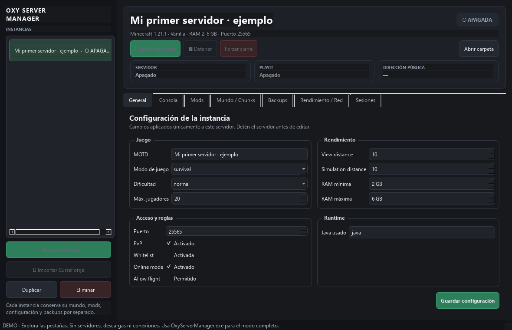
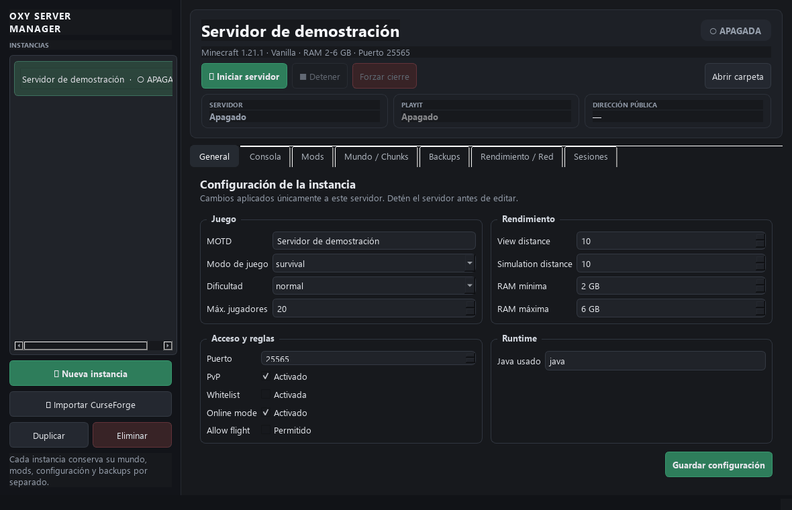

# Oxy Server Manager

**Organiza tus servidores de Minecraft desde un panel para Windows.** Cada instancia conserva por separado su mundo, mods, configuración y respaldos.

**[Descargar y probar](https://github.com/AlbertoVJ/oxy-server-manager-app/releases/latest/download/OxyServerManager-Windows-x64.zip)** · [Guía rápida](GUIA.md)

## Pruébalo sin instalar Minecraft

1. Descarga el ZIP y **extrae toda la carpeta**.
2. Abre **1 - Probar demo.vbs**.
3. Explora los paneles de configuración, mods, respaldos y rendimiento.

La demo trae una instancia ficticia y no inicia servidores ni descarga Minecraft. Python y la interfaz ya están incluidos.

## Para usarlo de verdad

Cierra la demo y abre **OxyServerManager.exe**. Puedes crear una instancia o importar un Server Pack oficial de CurseForge. Java, Minecraft, modpacks y la conexión de red se preparan aparte para tu servidor.

## Qué reúne en un solo lugar

- Instancias separadas y configuración de memoria/Java.
- Importación y administración de modpacks.
- Respaldos y restauración protegida.
- Pregeneración de zonas con Chunky.
- Panel de rendimiento e historial de sesiones.

El GIF muestra navegación con datos ficticios, sin un servidor iniciado. La versión portátil se comprobó en Windows 11 x64: arranque del ejecutable, siete paneles y bloqueo del inicio de servidores en demo. El arranque de un modpack real depende de su versión, Java y equipo; no se promete una capacidad de jugadores sin evaluarlo.

## ¿Quieres dejar tu servidor preparado?

Puedo preparar una instancia y entregarte instrucciones de uso y respaldo. [Abre una consulta](https://github.com/AlbertoVJ/oxy-server-manager-app/issues/new) indicando versión, modpack y equipo disponible; acordamos alcance y cotización antes de comenzar.

Si te resulta útil, una estrella ⭐ y tus [comentarios o problemas](https://github.com/AlbertoVJ/oxy-server-manager-app/issues) ayudan a mejorar el proyecto.

Proyecto personal de [Alberto Jasso](https://github.com/AlbertoVJ), desarrollado con asistencia de IA. Este repositorio publica la presentación y las descargas; el historial de desarrollo se conserva en privado.

### English

A Windows panel for managing Minecraft server instances, mods and backups. Download the portable x64 ZIP and open the demo launcher to explore without installing Minecraft. Open OxyServerManager.exe for real server management. Java and Minecraft server components are separate.
